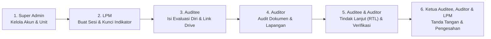

# SI-AMI ITBMP — Sistem Informasi Audit Mutu Internal

**SI-AMI ITBMP** adalah platform manajemen **Audit Mutu Internal (AMI)** terintegrasi berbasis web untuk lingkungan **Institut Teknologi dan Bisnis Muhammadiyah Purbalingga (ITBMP)** yang mencakup siklus **PPEPP (Penetapan, Pelaksanaan, Evaluasi, Pengendalian, dan Peningkatan)** pada Program Studi:
- **Bisnis Digital**
- **Aktuaria**
- **Perancangan Wilayah dan Kota (PWK)**

---

## 🏗️ Arsitektur Sistem

Sistem dibangun dengan arsitektur modern *full-stack serverless* yang cepat, aman, dan mudah diskalakan:

### 1. Stack Teknologi
- **Frontend & Backend Framework**: **Next.js 15 (App Router)** dengan *React Server Components (RSC)* dan *Server Actions*.
- **Bahasa Pemrograman**: **TypeScript** (*strict type safety*).
- **Database & ORM**: **PostgreSQL (Neon Serverless)** yang diakses melalui **Prisma ORM**.
- **Antarmuka (UI/UX)**: **Tailwind CSS v4** dengan desain *High-Contrast Neo-Brutalist* yang responsif dan ramah pembacaan instrumen panjang.
- **Keamanan & Autentikasi**:
  - Sesi berbasis **JWT (`jose`)** yang disimpan dalam *HTTP-Only Cookie*.
  - *Role-Based Access Control (RBAC)* ketat di level server untuk setiap rute dan aksi data.
  - Aturan **Anti Konflik Kepentingan (*Cross-Prodi Rule*)**: Auditor tidak dapat mengaudit Program Studi asal (*homebase*)-nya sendiri.

### 2. Struktur Modul Utama
```text
src/
├── app/
│   ├── (app)/
│   │   ├── admin/          # Manajemen Akun & Sesi Pelatihan (Super Admin)
│   │   ├── lpm/            # Manajemen Sesi AMI, Master Indikator SPMI, Pantau & Rekap (LPM)
│   │   ├── auditee/        # Pengisian Evaluasi Diri, Bukti Google Drive & RTL (Auditee)
│   │   ├── auditor/        # Pemeriksaan Dokumen, Audit Lapangan & Verifikasi RTL (Auditor)
│   │   ├── training/       # Pemilihan Kelompok & Simulasi Pelatihan AMI (Dual Role)
│   │   └── password/       # Pengaturan Keamanan Kata Sandi Pengguna
│   ├── api/
│   │   └── rekap-excel/    # Mesin Cetak Laporan Resmi (Print/PDF) & Ekspor Excel (.xls)
│   └── login/              # Halaman Autentikasi Pengguna
├── components/             # Komponen UI Terpadu, Papan Tanda Tangan Digital & Tabel Rekap
└── lib/                    # Konfigurasi Prisma, Autentikasi JWT, Enkripsi & Utilitas Sesi
```

---

## 🔄 Alur Penggunaan Sistem (Workflow AMI)

Siklus pelaksanaan Audit Mutu Internal di **SI-AMI ITBMP** berjalan secara berurutan melalui **4 peran utama**:



### Tahap 1 — Persiapan & Penetapan Instrumen (LPM)
1. **Pembuatan Sesi AMI**: LPM membuat Sesi AMI berdasarkan **Tahun Akademik**, **Semester (Ganjil/Genap)**, dan **Program Studi**.
2. **Penyusunan Standar & Indikator SPMI**:
   - LPM dapat mengimpor instrumen secara massal melalui **Excel (`.xlsx`)** maupun menambahkan secara manual per Standar SPMI.
   - Setelah instrumen siap, LPM menekan tombol **Kunci & Terbitkan Indikator** (*Source-Lock*) agar indikator tampil di halaman Auditee dan Auditor.
3. **Penugasan Tim Auditor & Penunjukan Ketua**:
   - Sistem secara otomatis memvalidasi agar **Auditor berasal dari lintas Program Studi** (bebas konflik kepentingan).
   - LPM menetapkan **Ketua Auditee** dan **Ketua Auditor** untuk keperluan penandatanganan lembar pengesahan laporan.

### Tahap 2 — Pengisian Evaluasi Diri & Bukti Dukung (Auditee)
1. **Filter & Navigasi per Standar**: Auditee memilih Standar SPMI dan membuka kartu indikator yang ingin dikerjakan (*Smart Single-Expand*).
2. **Pengisian Klaim & Tautan Bukti**: Auditee mengisi narasi evaluasi diri dan menempelkan **tautan Google Drive / Google Docs** dokumen bukti.
3. **Penyimpanan Otomatis & Kontribusi Tim**: Setiap indikator mencatat nama dosen pengisi dan menyimpan draf ketikan secara otomatis di peramban sebelum dikirim ke server.

### Tahap 3 — Audit Dokumen & Audit Lapangan (Auditor)
1. **📄 1. Audit Dokumen**:
   - Auditor memeriksa klaim serta membuka tautan bukti Google Drive Auditee.
   - Auditor memberikan status pemeriksaan dokumen (*Sesuai, Perlu Konfirmasi Lapangan, Belum Diisi, dsb.*) beserta catatan dan mengunci hasil pemeriksaan dokumen.
2. **🏛️ 2. Audit Lapangan**:
   - Auditor menetapkan klasifikasi hasil audit: **Melampaui Standar**, **Mencapai Standar**, **Observasi (OB)**, **KTS Minor**, atau **KTS Mayor**, lengkap dengan uraian temuan lapangan serta rekomendasi perbaikan.

### Tahap 4 — Rencana Tindak Lanjut / RTL (Auditee & Auditor)
1. Indikator dengan temuan **OB**, **KTS Minor**, atau **KTS Mayor** otomatis masuk ke daftar wajib **RTL**.
2. **Auditee** mengisi rencana perbaikan beserta tautan Google Drive bukti tindak lanjut.
3. **Auditor** memeriksa bukti perbaikan pada tab **🛠️ 3. Verifikasi RTL** dan mengubah status menjadi **Terverifikasi** apabila telah sesuai.

### Tahap 5 — Tanda Tangan Digital, Pengesahan & Cetak Laporan
1. **Ketua Auditee**, **Ketua Auditor**, dan **Kepala LPM** membubuhkan tanda tangan digital (melalui unggah gambar tanda tangan transparan otomatis atau coret langsung di layar).
2. Demi efisiensi penyimpanan server, citra tanda tangan memiliki masa simpan sementara otomatis (*auto-expiry* 3 menit) untuk keperluan pencetakan lembar pengesahan.
3. Laporan akhir dapat langsung dicetak ke **PDF / Printer (Landscape Resmi)** atau diunduh dalam format **Microsoft Excel (`.xls`)**.

---

## 🎓 Mode Sesi Pelatihan AMI (Training Sandbox)

Untuk kegiatan pelatihan atau *workshop* calon Auditor/Auditee kampus:
- **Super Admin** dapat membuka menu **🎓 Sesi Training** untuk membuat kelompok-kelompok latihan terisolasi dan mengimpor puluhan akun peserta sekaligus via Excel/Generator.
- Peserta pelatihan memilih kelompoknya sendiri saat masuk dan memiliki akses **Dual Role** (dapat berlatih sebagai **Auditee** sekaligus **Auditor** di kelompoknya) tanpa menyentuh data Sesi AMI Program Studi utama.
- Setelah pelatihan selesai, seluruh sesi dan akun pelatihan dapat dibersihkan kembali dalam satu klik.
